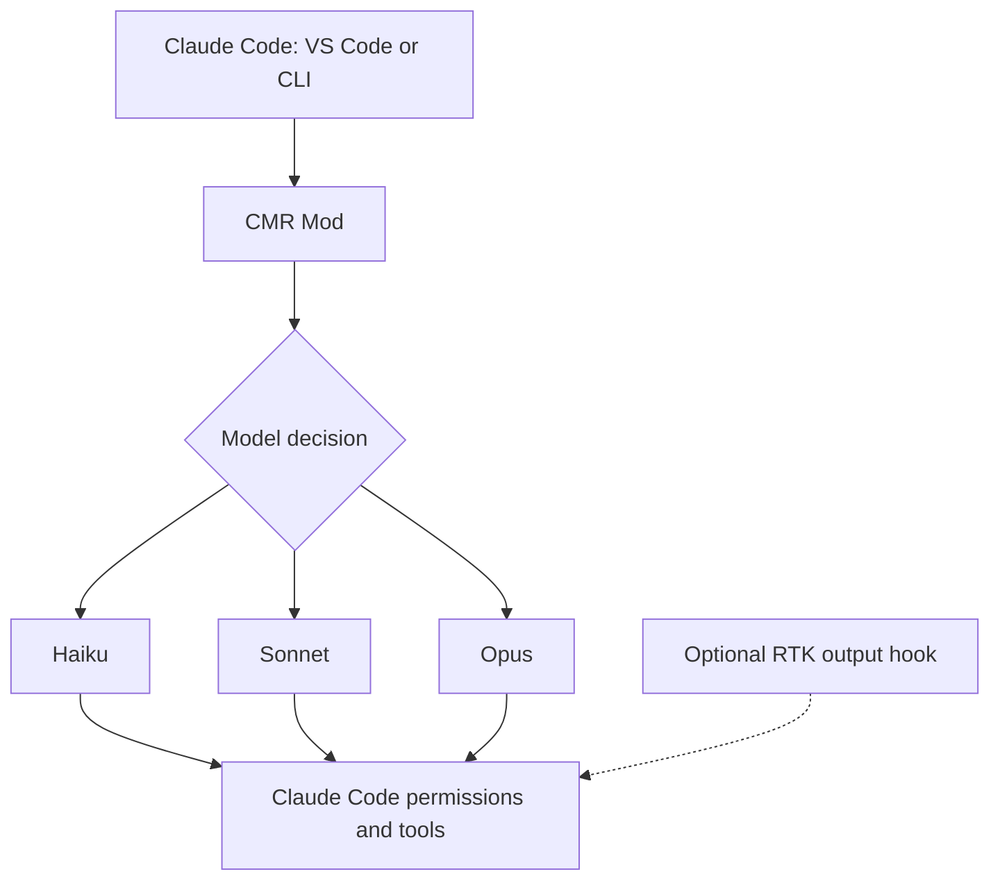

# CMR — Claude Model Router

<p align="center"><strong>Local, opt-in model routing for Claude Code.</strong><br>Select Haiku, Sonnet, or Opus without an extra classifier API call.</p>

<p align="center">
<a href="https://github.com/Weslley08/cmr/actions/workflows/ci.yml"></a>
<a href="https://github.com/Weslley08/cmr/releases"></a>
<a href="LICENSE"></a>
</p>

<p align="center"><a href="README.md">English</a> · <a href="README_pt.md">Português</a> · <a href="INSTALL.md">Installation</a> · <a href="docs/guide/getting-started/quick-start.md">Quick Start</a> · <a href="docs/contributing/ARCHITECTURE.md">Architecture</a></p>

> **Experimental 0.1.0:** CI and local tests exist, but routing in a real Claude Code / VS Code session **has not yet been validated**. There is no published WinGet, Homebrew, or GitHub binary release.

## What CMR does

CMR is a Claude Code Mod supported by a native Rust management CLI. It classifies the user's latest prompt locally and attempts to select a model through the Claude Code runtime. It starts **off**; run `/cmr auto` to enable.

| Request | Balanced profile |
|---|---|
| Scoped, read-only request | Haiku |
| Routine implementation and tests | Sonnet |
| Architecture or large refactor | Opus |
| Critical security or production issue | Opus |
| Explicit model selection | Requested model |

The initial heuristics can be wrong. There is **no proven savings claim**, automatic retry escalation, or persistent tracking yet. Existing permission checks and subagent choices remain the Claude Code runtime's responsibility.

## How it works



CMR and [RTK](https://github.com/rtk-ai/rtk) are **independent**. RTK compacts Bash command output; CMR attempts to choose the model. Neither needs the other.

## Installation

The eventual RTK-style one-time installer will be:

```powershell
# Planned only — WinGet listing not published yet
winget install Weslley08.CMR
cmr init -g
cmr doctor
```

### Preview using the official Claude Code extension

In the Claude Code plugin manager, add `Weslley08/cmr` as a **Claude Code plugin marketplace source**, then install `model-router@weslley08-cmr` at user scope. This marketplace is only a plugin catalog, **not the VS Code Marketplace and not WinGet**.

Restart the Claude Code session, then:

```text
/cmr status
/cmr mode balanced
/cmr auto
/cmr stats
/cmr off
```

Alternatively, if the standalone Claude Code CLI is available:

```bash
claude plugin marketplace add Weslley08/cmr
claude plugin install model-router@weslley08-cmr
```

Read [INSTALL.md](INSTALL.md) for the full procedure and safety notes.

## Repository structure

Organized using conventions inspired by RTK, with CMR-specific functionality isolated:

```text
cmr/
├── src/
│   ├── main.rs
│   ├── core/                 # Parsing and OS integration
│   ├── cmds/                 # CLI commands
│   └── analytics/            # Metrics guidance
├── plugins/model-router/     # Claude Code Mod + tests
├── .claude-plugin/           # Optional Claude Code plugin catalog
├── hooks/                    # Integration documentation
├── tests/                    # Rust CLI integration tests
├── docs/guide/               # User guides
├── docs/contributing/        # Architecture
├── examples/
├── scripts/
├── packaging/
├── .github/workflows/
├── Cargo.toml
├── Cargo.lock
├── INSTALL.md
├── CHANGELOG.md
└── LICENSE
```

## Development

Rust stable and Node.js 20+:

```bash
cargo fmt --all -- --check
cargo clippy --all-targets -- -D warnings
cargo test --all-targets
node --test plugins/model-router/tests/*.test.js
node scripts/check-marketplace.mjs
```

These tests are **not** proof of working live model selection. See [Architecture](docs/contributing/ARCHITECTURE.md), [Distribution](docs/DISTRIBUTION.md), [Contributing](CONTRIBUTING.md), and [Security](SECURITY.md).

**License:** [MIT](LICENSE).
