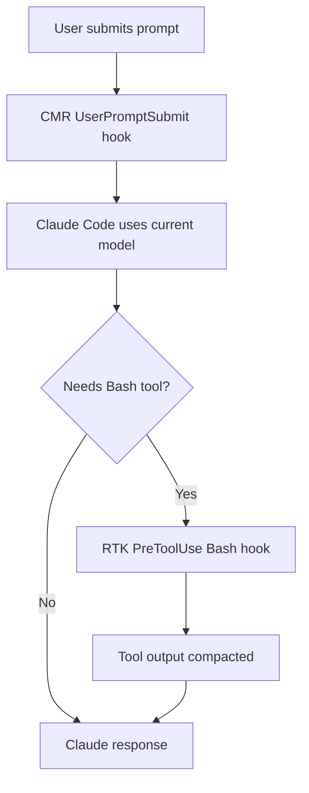

# CMR — Claude Model Router

<p align="center"><strong>A native model recommender and Claude Code session launcher — no plugin or marketplace.</strong></p>

<p align="center">
<a href="https://github.com/Weslley08/cmr/actions/workflows/ci.yml"></a>
<a href="https://github.com/Weslley08/cmr/releases"></a>
<a href="LICENSE"></a>
</p>

<p align="center"><a href="README_pt.md">Português</a> · <a href="INSTALL.md">Installation</a> · <a href="docs/contributing/ARCHITECTURE.md">Architecture</a> · <a href="CHANGELOG.md">Changelog</a></p>

> **Experimental v0.1.0.** This is a standalone Rust executable for Windows, macOS and Linux. It is **not** a Claude Code plugin, Mod, marketplace entry, API proxy or interception of credentials. GitHub Releases, WinGet and Homebrew installation are being prepared.

## Why CMR?

CMR and [RTK](https://github.com/rtk-ai/rtk) solve different problems:

- **CMR** analyzes task text and recommends Haiku, Sonnet or Opus with deterministic local rules.
- **RTK** compacts supported shell-tool output using a `PreToolUse` hook.

One binary, `cmr`, can register a native `UserPromptSubmit` hook in `~/.claude/settings.json`. The hook works across **locally running Claude Code CLI and the official VS Code extension**, where the native hooks are supported.

**Important limitation:** Native `UserPromptSubmit` hooks can add context or display a message but **cannot change the active Claude model**. Likewise, `PreModelSwitch` can approve/block an already-requested switch, not initiate one. CMR's native hook reports its recommendation honestly. The `cmr launch` command can **actually select a model when starting a Claude Code CLI session**, via the official `claude --model` flag. Automatic per-prompt model switching in VS Code is **not** claimed or implemented. No secret workaround or undocumented API is used.

## Usage

```sh
cmr init -g --dry-run    # Preview settings.json modifications
cmr init -g              # Install native hook globally; preserves RTK
cmr doctor               # Diagnose Claude Code and RTK
cmr status               # Verify hook registration
cmr recommend "List files in src"          # Prints: haiku (advisory only)
cmr recommend "Design a distributed system" # Prints: opus (advisory only)
cmr launch "Implement an endpoint with tests" # Starts CLI with --model sonnet
cmr uninstall -g         # Remove only the CMR hook
```

In the VS Code extension, the hook runs before a submitted prompt and may display an **advisory recommendation** such as `CMR suggests sonnet`. This does **not** imply the model actually switched; use the Claude Code model picker or `/model` to switch manually.

## Execution order: CMR then RTK



CMR and RTK do not compete for hook order. If Claude never calls Bash, RTK does not run.

## Install

Until binaries and package manager manifests have been published, build from source:

```sh
git clone https://github.com/Weslley08/cmr.git
cd cmr
cargo build --release
cargo test --all-targets
```

Windows produces `target/release/cmr.exe`; Linux/macOS produce `target/release/cmr`. Add the directory to PATH before `cmr init -g`. See [INSTALL.md](INSTALL.md).

Planned channels **(not currently published)**:

```sh
winget install Weslley08.CMR       # Windows, after approval
brew install weslley08/tap/cmr    # macOS/Linux, after tap publication
```

## Project structure

Inspired by RTK's clear split between `src/core`, `src/cmds`, `src/analytics`, `hooks`, `tests`, `docs`, `scripts` and CI:

```text
cmr/
├── src/
│   ├── main.rs
│   ├── core/              # CLI parsing, routing and safe JSON hooks
│   ├── cmds/              # init, uninstall, launch, recommend, doctor, status
│   └── analytics/
├── hooks/                 # Native hook integration docs
├── tests/                 # Rust CLI integration tests
├── docs/                  # Guides, architecture and distribution
├── examples/
├── scripts/
├── packaging/
├── .github/workflows/
├── Cargo.toml
├── README_pt.md
├── INSTALL.md
└── LICENSE
```

## Development

```sh
cargo fmt --all -- --check
cargo clippy --all-targets -- -D warnings
cargo test --all-targets
cargo build --release
```

There is no plugin or JavaScript runtime dependency. The hook processes prompt text locally and sends no analytics or prompts to other services. The installed hook must be visible in `settings.json`; the RTK hook stays intact.

## Status and license

**Not released as a package yet.** Cross-platform CI validates native builds; the CLI's effective `--model` launch requires the standalone Claude Code CLI. License [MIT](LICENSE).
